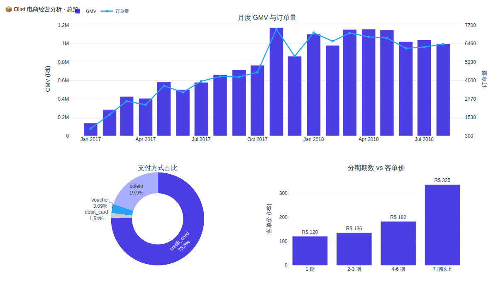
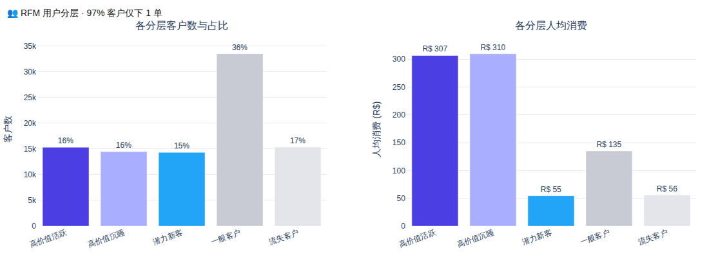
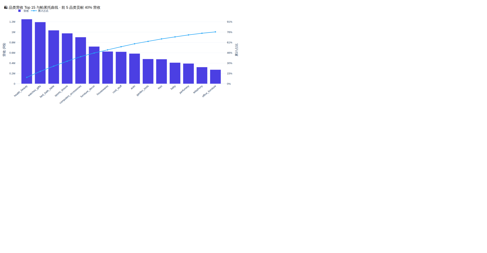
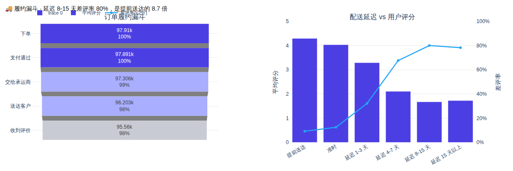

#  Olist 电商经营分析平台

> 真实数据 · 可复现链路 · 可交互看板

[](https://github.com/solarawu/olist-ecommerce-bi/actions)
[](https://www.python.org/downloads/)
[](https://duckdb.org/)
[](https://streamlit.io/)
[]()
[](LICENSE)

---

##  项目亮点

| 亮点 |
| --- |
| 9 张业务表 / 99,441 笔真实订单 |
| staging → 维度/事实 → 指标 三层数仓 |
| 20+ 指标 + 口径文档 + 质量检查脚本 |
| 4 页 Streamlit 看板，支持时间与地区下钻 |
| 一条命令复现：`python -m src.download && python -m src.build_warehouse && python -m src.run_metrics` |
| GitHub Actions 自动跑完整链路 |

##  核心业务发现

| 结论 | 数字 |
| --- | --- |
| **履约时效是差评的第一驱动因素** | 延迟 8–15 天差评率 **80%**，提前送达仅 **9.2%**，**8.7 倍差距** |
| **分期显著撬动客单价** | 7 期以上订单 R$ 334.83 vs 1 期 R$ 120.46，**2.8 倍** |
| **复购率极低** | 仅 **3.0%**，97% 客户只下 1 单；RFM 的 F 维度实际不参与区分 |
| **品类集中度不高** | 前 5 品类仅贡献 **39.8%** 营收，不存在单一品类依赖 |
| **漏斗内部无明显流失** | 各环节转化率均 > 96%，真正的流失在下单前取消环节 |

>  数据集特性：90%+ 客户只买一次，F 维度的失效是数据本身决定的，已在文档和看板中显式标注。

##  看板预览

| 总览 | 用户分层 |
| --- | --- |
|  |  |

| 品类帕累托 | 履约漏斗 |
| --- | --- |
|  |  |

> 替换方法：启动看板后截图放到 `screenshots/` 目录，文件名保持一致即可。

##  技术栈

| 层 | 选型 | 理由 |
| --- | --- | --- |
| 数据处理 | **DuckDB + SQL** | 单机 OLAP，SQL 可直接复用到 Snowflake / BigQuery |
| 取数与检查 | **Python (duckdb, pandas)** | 轻量，无重依赖 |
| 可视化 | **Streamlit + Plotly** | 纯 Python，可免费部署 |
| 工程化 | **GitHub Actions** | PR 自动跑完整链路 |

##  目录结构

```
olist-ecommerce-bi/
├── src/
│   ├── config.py              路径与连接配置
│   ├── download.py            下载并解压原始数据（公开数据集，无需登录）
│   ├── build_warehouse.py     staging → 维度表 / 事实表
│   ├── run_metrics.py         执行指标层 SQL
│   └── quality_check.py       数据质量检查 → docs/data_quality_report.md
├── sql/
│   ├── 00_staging.sql         原始 CSV → staging（只做类型转换，不做业务过滤）
│   ├── 01_dims.sql            维度表
│   ├── 02_facts.sql           事实表
│   └── metrics/               指标层（每个主题一个文件）
│       ├── 01_monthly_kpis.sql
│       ├── 02_rfm.sql
│       ├── 03_funnel.sql
│       ├── 04_delivery_vs_review.sql
│       ├── 05_category_pareto.sql
│       └── 06_payment_mix.sql
├── dashboard/
│   └── app.py                 Streamlit 看板（总览 / 用户 / 商品 / 履约）
├── docs/
│   ├── data_dictionary.md     数据字典：字段、粒度、已知问题
│   ├── metric_definitions.md  指标口径文档（权威定义）
│   └── data_quality_report.md 自动生成，每次 quality_check 覆盖
├── screenshots/               看板截图（需自行生成）
├── .github/workflows/ci.yml   CI：下载 → 建仓 → 指标 → 质量 → 看板 smoke test
├── .streamlit/config.toml     看板主题与部署配置
├── pyproject.toml             项目元数据
├── LICENSE                    MIT
└── CONTRIBUTING.md
```

##  快速开始

```bash
# 1. 安装依赖
pip install -r requirements.txt

# 2. 一键跑完整流程（下载 → 建仓 → 指标 → 质量检查）
python -m src.download
python -m src.build_warehouse
python -m src.run_metrics
python -m src.quality_check

# 3. 启动看板
streamlit run dashboard/app.py
```

全部在本机完成，无需服务器、GPU 或数据库。DuckDB 文件约 64MB，原始数据约 215MB。

也可以用模块脚本一键执行（`pyproject.toml` 中定义）：

```bash
pip install -e .
olist-download && olist-build && olist-metrics && olist-quality
```

## 🗃 数仓分层

```
CSV (raw)
  └─ staging.*        原始表 + 类型转换 + 去重，不做业务过滤
       ├─ dim_customer / dim_product / dim_seller / dim_date
       └─ fact_orders / fact_order_items
            └─ metrics.*   指标层，每个主题一个 SQL 文件
```

- `fact_orders`：订单粒度，含履约节点、支付、评分、延迟天数
- `fact_order_items`：订单明细粒度，含商品与卖家
- 客户粒度**统一用 `customer_unique_id`**：`customer_id` 是订单级标识，一个自然人可能对应多个

##  指标主题

| 主题 | 文件 | 核心指标 |
| --- | --- | --- |
| 月度经营 | `01_monthly_kpis.sql` | GMV、订单量、客单价、好评率、MoM |
| 用户分层 | `02_rfm.sql` | RFM 五档分层（NTILE(5) 窗口函数） |
| 履约转化 | `03_funnel.sql` | 下单 → 支付 → 承运 → 送达 → 评价 |
| 时效与体验 | `04_delivery_vs_review.sql` | 延迟分箱、差评率、平均评分 |
| 品类结构 | `05_category_pareto.sql` | 营收排名、帕累托累计占比 |
| 支付方式 | `06_payment_mix.sql` | 支付方式占比、分期期数与客单价 |

每个指标的**口径定义**（GMV 含不含运费、含不含取消单、客户用哪个 ID）详见 [docs/metric_definitions.md](docs/metric_definitions.md)。

##  数据质量

`python -m src.quality_check` 会跑 11 项自动检查，发现以下真实问题：

| 问题 | 数量 | 处理方式 |
| --- | ---: | --- |
| 客户主键重复（自然人被多 ID 计数） | 2,997 | 统一用 `customer_unique_id` 聚合 |
| 商品品类为空 | 610 | 归入 `unknown` |
| 一单多评 | 547 | 取最新一条 |
| 订单无支付记录 | 1 | `COALESCE(payment_total, 0)` |
| Delivered 订单缺签收时间 | 8 | 履约分析显式排除 |

##  部署

看板可直接部署到 **Streamlit Community Cloud** 免费托管：

1. 把仓库推到 GitHub
2. 打开 [share.streamlit.io](https://share.streamlit.io)，Connect Account → New App
3. Repository 选你的仓库，Branch 选 `main`，Main file path 填 `dashboard/app.py`
4. 注意：云端是全新环境，没有本地 data/ 目录。在 **Advanced settings → Secrets** 里留空（本项目不需要 secrets），在 **Settings → Modules and packages** 里添加 `python -m src.download && python -m src.build_warehouse && python -m src.run_metrics` 作为启动前脚本（或把 `data/warehouse/olist.duckdb` 一并提交，约 64MB）。

也可以用 GitHub Pages 托管 README + `screenshots/` 目录，作为项目展示页。

##  已知局限与路线图

- [ ] **卖家维度分析**（GMV / 单量 / 发货时效 Top N，卖家集中度）
- [ ] **留存 Cohort**（月度首单 cohort × 后续 N 月复购率）
- [ ] **同比 / 环比**（需处理 2018-09 之后数据稀疏的月份对齐逻辑）
- [ ] **季节性 / 节假日效应**（黑五、圣诞等巴西电商旺季）
- [ ] **Power BI 版本看板**（同一指标表做一份 Power BI，提升简历关键词覆盖）
- [ ] **退款与售后**（数据集无退款数据，已在文档注明）

##  参考资料

- [Kaggle - Brazilian E-Commerce Public Dataset by Olist](https://www.kaggle.com/datasets/olistbr/brazilian-ecommerce)
- [DuckDB Documentation](https://duckdb.org/docs/)
- [Kimball's Dimensional Modeling](https://www.kimballgroup.com/data-warehouse-business-intelligence-resources/books/data-warehouse-toolkit/)（星型模型理论来源）
- [Streamlit Docs](https://docs.streamlit.io/)

##  许可

MIT License · 数据来源：Olist 公开数据集（CC BY-NC-SA 4.0 许可）

##  支持

- 发现 Bug → 开 Issue
- 想贡献 → 先读 [CONTRIBUTING.md](CONTRIBUTING.md)
- 想求职内推或项目交流 → 在 Issue 里留信息
